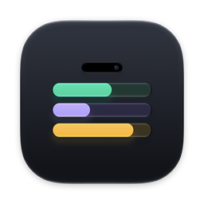
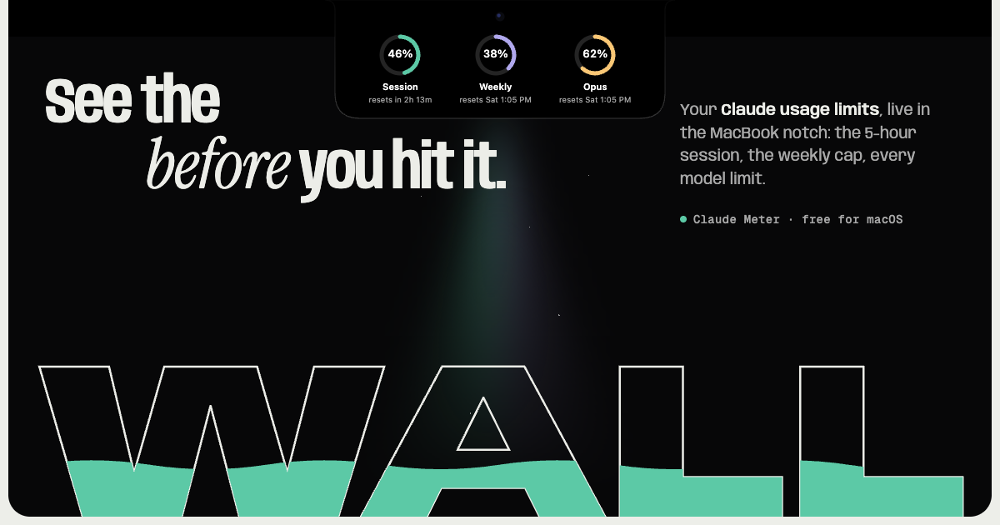

<p align="center"></p>

<h1 align="center">Claude Meter</h1>

<p align="center">Your Claude usage limits, live in the MacBook notch.<br>
<a href="https://claudemeter.vercel.app"><b>Download for Mac</b></a> · free · macOS 14.4+ · Apple Silicon & Intel</p>

<p align="center"></p>

Claude Meter turns the camera notch into a Dynamic-Island-style panel for your Claude subscription:
the 5-hour session, the weekly cap, and every per-model limit your account reports — so you see the
wall before you hit it.

- **Collapsed** — session and weekly hug the notch by default; right-click → Show limits for any mix of session, weekly and the model limit (e.g. Fable).
- **Hover** — the panel peeks open: three rings, reset countdowns, and a session forecast ("hits the cap in 1h 12m").
- **Click** — pin the full table with 6-hour sparklines. Right-click for settings.
- **Alerts** (opt-in) at 50/80/95% of a session and 80/95% of weekly and model limits.
- **Three looks** — Solid, Frosted, Liquid Glass. Works on Macs without a notch (a pill + optional menu-bar item) and hides in full-screen apps.
- **Two accounts?** It shows whichever one the Claude app is on. If Claude Code isn't signed in to that account yet, right-click → *Sign in the Claude app's account…* runs `claude auth login` for it in Terminal, in a profile of its own; right-click → Account picks one by hand.

## Requirements

Claude Code installed and signed in with a Claude **Pro or Max** plan. API-key (Console) logins aren't
supported. Extra sign-ins made with `CLAUDE_CONFIG_DIR` are found when the folder sits in your home
folder with "claude" in its name (`~/.claude-work`).

## Privacy

Claude Meter only reads the sign-ins Claude Code already saved on your Mac: Keychain items
`Claude Code-credentials` and, for an extra profile, `Claude Code-credentials-<hash>`, falling back to
each profile's `.credentials.json`. It never renews a sign-in, never writes or deletes a Keychain item
or file, and never sees the refresh token: Claude Code renews its own sign-in, and when the token has
run out the meter says so until `claude` runs again.

It reads the Keychain itself, so macOS names Claude Meter when it asks, and Always Allow lets only
Claude Meter in (an "Always Allow" for Apple's `security` tool would let every program in). It opens an
item only when Claude Code has saved a new sign-in there, and if you say no it doesn't ask again until
you choose *Allow Keychain access* in the right-click menu. The token is kept in memory only.

To know which account to show it reads the account ID the Claude app keeps in
`~/Library/Application Support/Claude/config.json`; it never touches the app's own sign-in. It talks to
`api.anthropic.com` (usage, and which account a sign-in belongs to) and, once a day, this project's site
for `version.json`, through a connection that keeps nothing on disk. No analytics, no account, no server.

## Build from source

```bash
./build.sh            # universal app in build/, ad-hoc signed
./build.sh dmg        # + dist/ClaudeMeter.dmg
./build.sh release    # Developer ID signed, notarized + stapled (maintainer only)
.build/release/ClaudeMeter --selftest            # unit checks
.build/release/ClaudeMeter --snapshot ./snaps    # render every UI state to PNG
```

Needs Xcode 26+ (for `actool` and the Liquid Glass icon). The website lives in `site/` (static, built
from `web/` with `node web/build.mjs`).

## Star it

If Claude Meter saved you from a mid-task lockout, a ⭐ helps other people find it.

---

Independent project. Not affiliated with or endorsed by Anthropic. Claude is a trademark of Anthropic, PBC.
MIT licensed.
